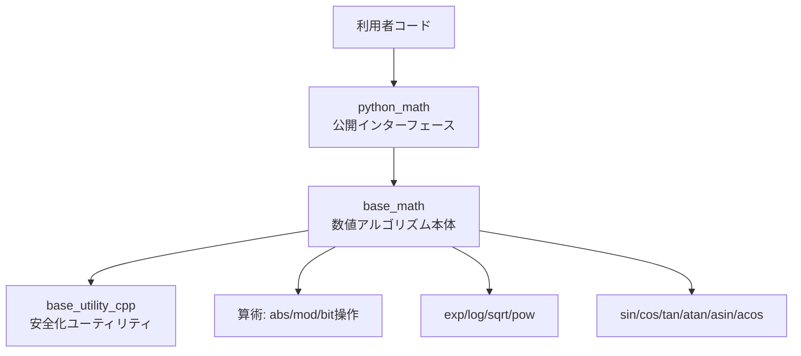

# 全体像と設計方針

## 1. このライブラリの狙い

このライブラリは、`<cmath>` 相当の数学処理を、**組込み向けの速度・安定性・依存制約**を意識して提供します。
特に、`python_math` を入口として利用しつつ、内部では `base_math` の複数アルゴリズムを切り替えて使える設計になっています。

## 2. レイヤ構成

- `python_math`:
  - スカラ（`T`）だけでなく `std::vector<T>`, `std::array<T, N>` への要素演算も提供
  - 利用者はこの名前空間を主に使う
- `base_math`:
  - 近似計算・反復法・テーブル参照などの中核アルゴリズムを実装
- `base_utility_cpp`:
  - `avoid_zero_divide`, `near_zero` など、安定化に必要な共通機能を提供

## 3. 実装モード（マクロ切替）

`base_math/base_math_macros.hpp` の定義で挙動が切り替わります。

| マクロ | 役割 |
|---|---|
| `BASE_MATH_USE_STD_MATH_` | 標準ライブラリ（`std::sin`, `std::exp` など）を優先使用 |
| `BASE_MATH_USE_ALGORITHM_DEPENDENT_ON_IEEE_754_STANDARD_` | IEEE754前提のビット操作系アルゴリズムを使用 |
| `BASE_MATH_USE_ROUGH_BUT_FAST_APPROXIMATIONS_` | 反復回数を減らして高速寄りに調整 |

## 4. アルゴリズム採用方針（要約）

本リポジトリの実装は、以下を組み合わせます。

- マクローリン展開（exp/sin/cos など）
- Newton法（log, rsqrt, sqrt 系）
- Chebyshev多項式近似（atan 系）
- テーブル参照 + スケーリング（exp/log 高速化）
- 角度正規化（`[-π, π]`）
- ゼロ除算回避・近傍ゼロ判定

詳細は次の章で関数群ごとに解説します。
