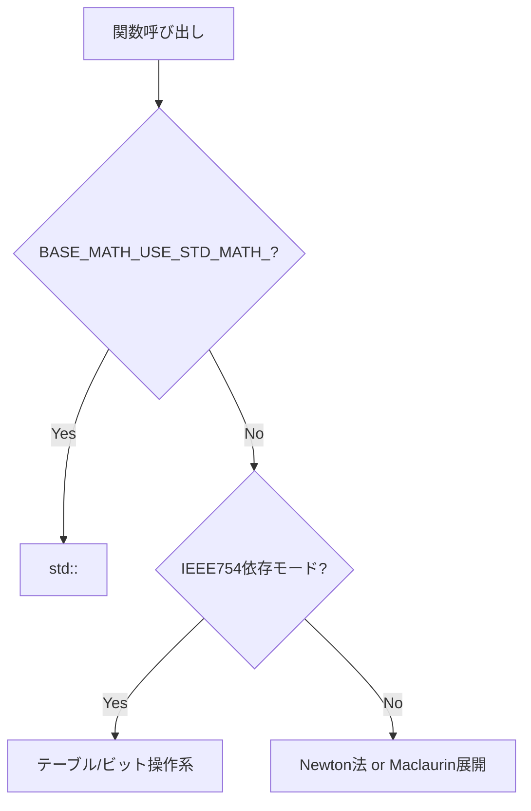

# 内部アルゴリズム: 指数・対数・平方根

対象: `sqrt`, `rsqrt`, `exp`, `exp2`, `log`, `log2`, `log10`, `pow`

## 1. アルゴリズム選択フロー



## 2. `rsqrt` / `sqrt`

### 2.1 `fast_inverse_square_root`（Quake系）
- 初期近似: `0x5f3759df` を使ったビットハック
- 1回のNewton補正: `y = y * (1.5 - x*y*y)`
- 非正値や極小値は `division_min` でクランプして安定化

### 2.2 `sqrt_extraction`（2進数の開平計算）

`sqrt_extraction` は、IEEE754 のビット表現を使って、**2進数の開平計算（bit-by-bit の平方根抽出）**を行う実装です。
本コードでは `sqrt_extraction_double` / `sqrt_extraction_float` として実装され、テンプレート再帰で反復回数を制御します。

考え方は次のとおりです。

1. 入力浮動小数点を符号・指数・仮数へ分解
2. 仮数部を2bitずつ走査し、平方根の次ビット候補を判定
3. 「引けるかどうか」を比較して部分余りを更新（筆算の開平法と同じ発想）
4. 反復後、指数を半分に調整して再構成

この方式は、除算や高次多項式を使わず、比較・シフト・加減算中心で進むため、
環境によっては一定の実行時間特性を持ちやすいのが利点です。

### 2.3 `rsqrt_newton_method`
- `frexp` で指数・仮数に分解し初期値を生成
- 補正式を適用後、テンプレート再帰で反復
- `SQRT_REPEAT_NUMBER` で反復回数を制御（高速寄り/高精度寄り）

### 2.4 `sqrt`
- 実装は基本的に `sqrt(x) = x * rsqrt(x)` 路線
- モードに応じて:
  - `std::sqrt`
  - IEEE754依存の `sqrt_extraction`
  - Newton法ベース

## 3. `exp` / `exp2`

## 3.1 `exp_maclaurin_expansion`

`exp(x)` を次の形で計算:

1. `x = n*ln(2) + r` に分解
2. `exp(r)` をマクローリン展開
3. `ldexp(result, n)` で `2^n` を掛ける

この分解により、展開対象 `r` を小さく保ち、収束と安定性を改善します。

### 3.2 テーブル併用版 `exp_*_maclaurin_expansion_with_table`
- `TABLE_FOR_EXP_FLOAT/DOUBLE` を参照して基底値を高速生成
- 残差だけ多項式で補正
- 反復は `EXP_MACLAURIN_WITH_TABLE_REPEAT_NUMBER` で制御

### 3.3 `exp2`
- `x = n + remainder` に分離
- `2^remainder` を級数で近似
- 最後に `ldexp(result, n)` でスケール

## 4. `log` / `log2` / `log10`

## 4.1 `log_newton_method`

`log(x)` の流れ:

1. `x <= 0` は `LOG_OUTPUT_MIN` を返す
2. `LOG_SCALE_FACTOR`（実装値 5.0）で `scaled_x` を収束しやすい範囲へスケーリング
3. 初期値 `guess = scaled_x - 1`
4. Newton反復
   `guess = guess - (exp(guess)-scaled_x)/exp(guess)`
5. スケール分を `guess + scale*log(LOG_SCALE_FACTOR)` で戻す

## 4.2 テーブル版 `log_maclaurin_expansion_with_table`
- 浮動小数点を指数・仮数に分解
- 区間テーブル（`TABLE_FOR_LOG_DOUBLE` など）で初期近似
- 残差を級数で補正

## 4.3 `log2`, `log10`
- 共通思想: `log(x)` を求めて定数除算
  - `log2(x) = log(x) / LN_2`
  - `log10(x) = log(x) / LN_10`
- 標準関数モード以外でもこの構造を維持して実装分岐を最小化

## 5. `pow`

`pow(x, y)` は基本的に以下の合成です。

```text
pow(x, y) = exp( y * log(x) )
```

- `pow_base_math`: `log_newton_method` + `exp_maclaurin_expansion`
- `pow_maclaurin_expansion_with_table`: `log_*_with_table` + `exp_*_with_table`
- モードにより `std::pow` へ切替可能

## 6. 精度・速度調整ポイント

| 定数/設定 | 意味 |
|---|---|
| `EXP_REPEAT_NUMBER` | `exp` 級数項数 |
| `EXP2_REPEAT_NUMBER` | `exp2` 級数項数 |
| `LOG_REPEAT_NUMBER` | `log` Newton反復数 |
| `SQRT_REPEAT_NUMBER` | `sqrt/rsqrt` 反復数 |
| `BASE_MATH_USE_ROUGH_BUT_FAST_APPROXIMATIONS_` | 反復数を減らし高速化 |

設計上、**過入力時クランプ（`EXP_INPUT_MAX` など）**も重要です。これによりオーバーフローやアンダーフロー由来の破綻を抑えています。
