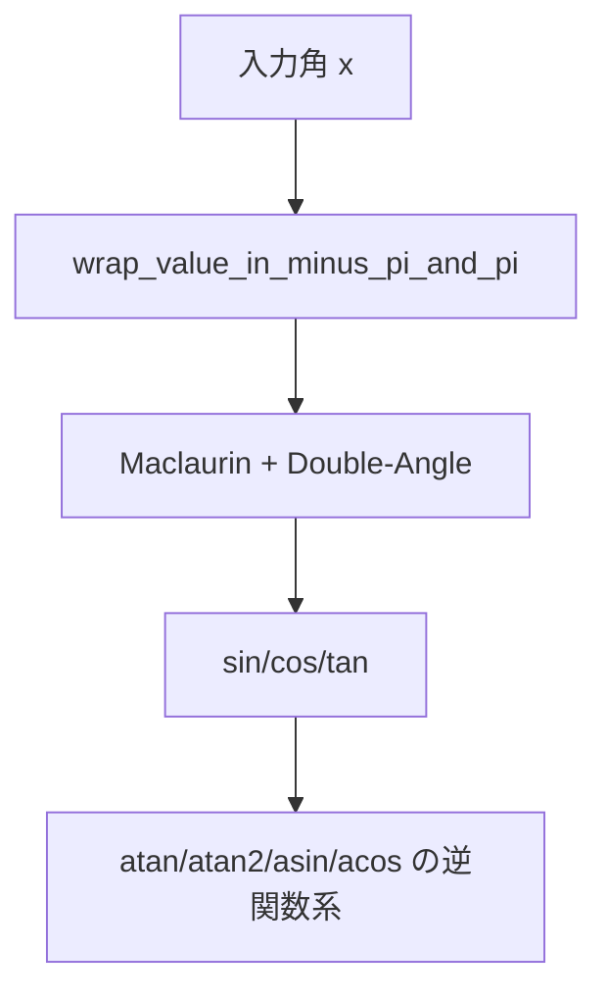

# 内部アルゴリズム: 三角・逆三角・双曲線関数

対象: `sin`, `cos`, `tan`, `atan`, `atan2`, `asin`, `acos`, `sinh`, `cosh`, `tanh`

## 1. 角度系アルゴリズムの骨格



## 2. `sin` / `cos` / `tan`

## 2.1 角度正規化

`wrap_value_in_minus_pi_and_pi` で角度を `[-π, π]` に折り返し、級数近似の誤差増幅を抑えます。

## 2.2 Double-Angle + Maclaurin

`cos_maclaurin_expansion_with_DoubleAngleFormula` と
`sincos_maclaurin_expansion_with_DoubleAngleFormula` が中心です。

- 小さい角度領域へ圧縮して多項式近似
- 反復的に倍角公式を適用して元スケールへ復元
- `sin` は `sin(x)=cos(x-π/2)` を利用

この構造により、直接高次多項式を評価するより係数制御しやすく、組込み環境での実装効率が高くなります。

## 2.3 `tan`

`tan = sin / cos` で計算し、分母は `avoid_zero_divide` で保護します。
（`cos ≈ 0` 近傍の過大値・不安定化を緩和）

## 3. `atan` / `atan2`

## 3.1 `atan_chebyshev`

- 基本近似: Chebyshev係数列を用いた多項式評価
- `|x| > 1` では
  `atan(x) = sign(x)*π/2 - atan(1/x)`
  の形でレンジ変換して精度改善
- `atan_chebyshev_core_wide` では `|x| > 0.5` のとき半角系変換で収束域へ寄せる

## 3.2 `atan2_chebyshev`

象限判定を明示分岐で実装:

- `x,y` とも0近傍: 0
- `x>0`: `atan(y/x)`
- `x<0,y>=0`: `atan(y/x)+π`
- `x<0,y<0`: `atan(y/x)-π`
- `x≈0`: `±π/2`

`near_zero` によって軸近傍の不連続を安定化しています。

## 4. `asin` / `acos`

## 4.1 `asin_chebyshev`

`asin` は次の恒等式ベースで実装:

```text
asin(x) = 2 * atan( x / (1 + sqrt(1 - x^2)) )
```

- `atan` は Chebyshev
- `sqrt` は `sqrt_newton_method`
- 入力域外（`x>=1`, `x<=-1`）は `±π/2` にクランプ

## 4.2 `acos_chebyshev`

```text
acos(x) = π/2 - asin(x)
```

の関係を利用し、`asin` 系実装を再利用します。

## 5. 双曲線関数 `sinh` / `cosh` / `tanh`

`exp` 系を再利用して実装:

- `sinh(x) = (exp(x) - exp(-x))/2`
- `cosh(x) = (exp(x) + exp(-x))/2`
- `tanh(x) = (exp(x) - exp(-x)) / (exp(x) + exp(-x))`

`tanh` の分母も `avoid_zero_divide` で保護されます。

## 6. 実装上の要点

- 三角系は「**角度正規化 + 近似式 + 安全化**」の3段構造
- 逆三角系は「**レンジ変換 + Chebyshev多項式**」が中心
- 双曲線系は「**exp再利用**」で実装を統一

この統一方針により、コード規模を抑えつつ、速度/精度チューニング点（反復回数・テーブル使用）を集中管理できます。
